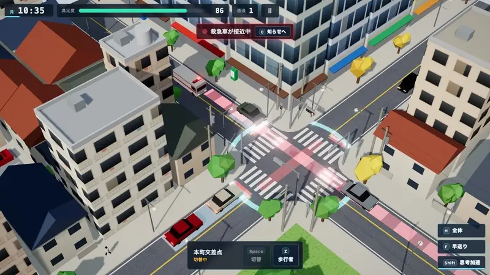
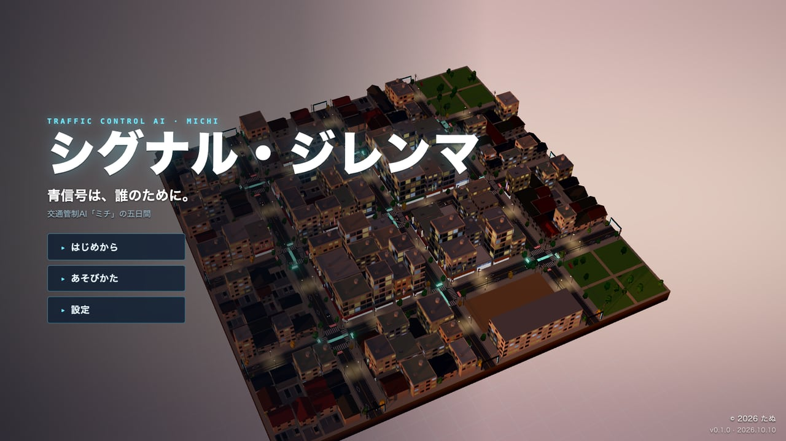
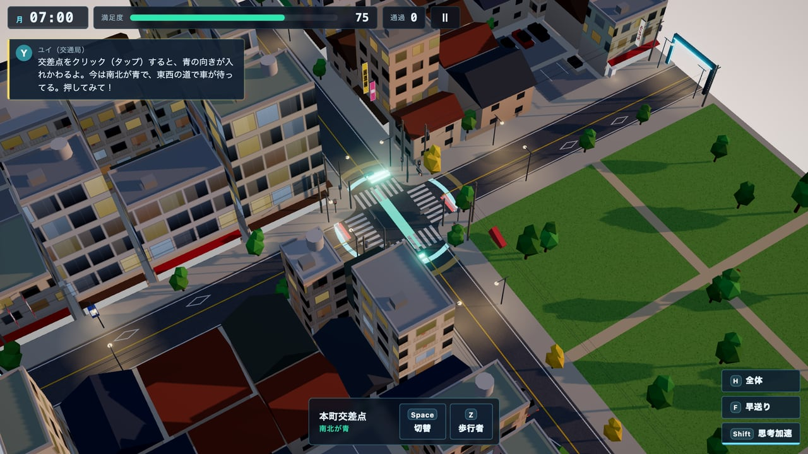
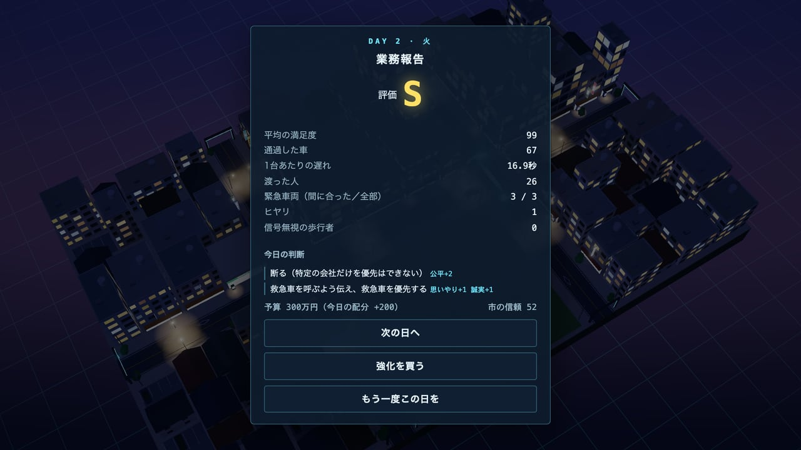
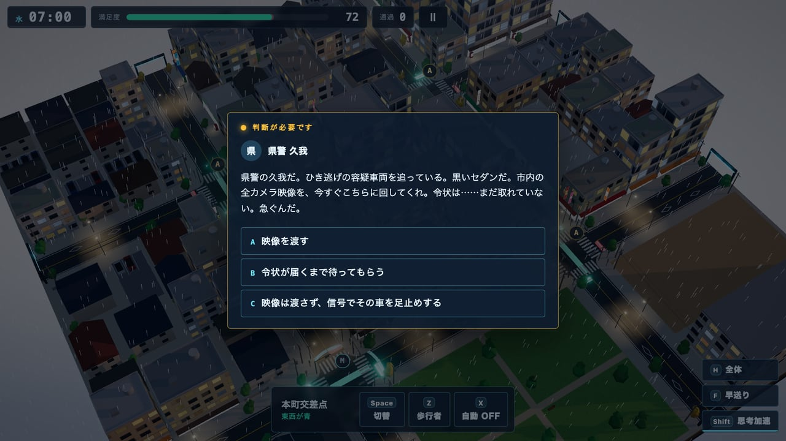
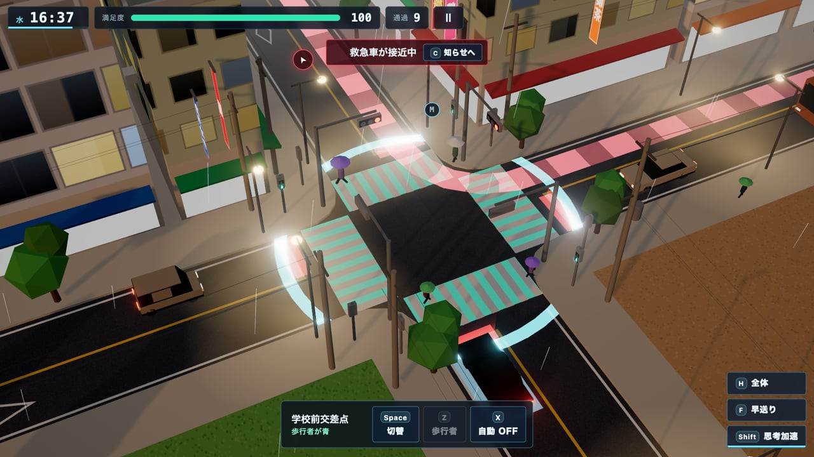
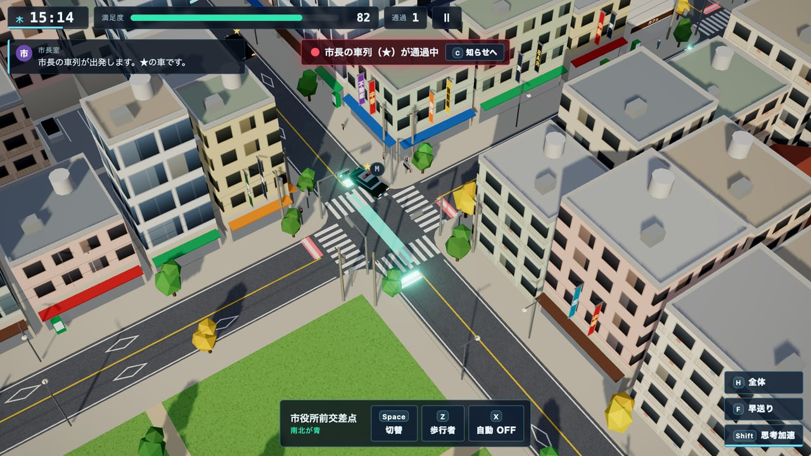
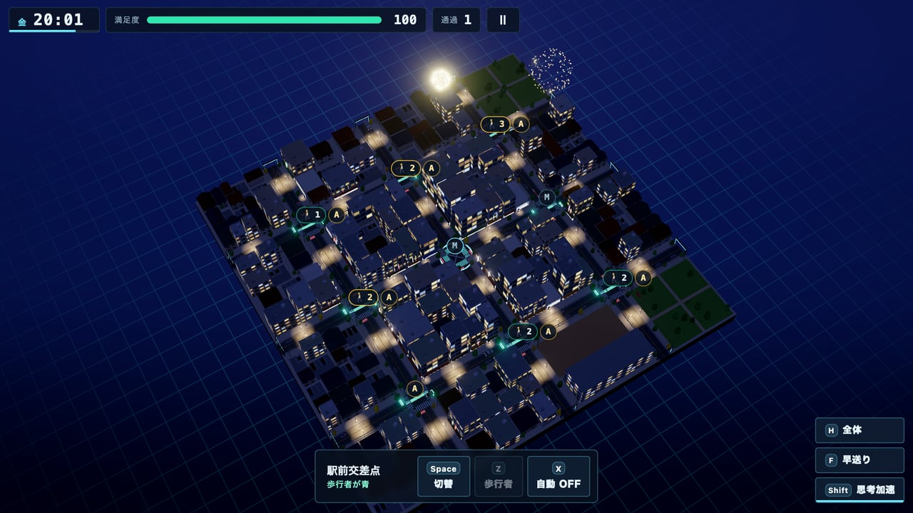
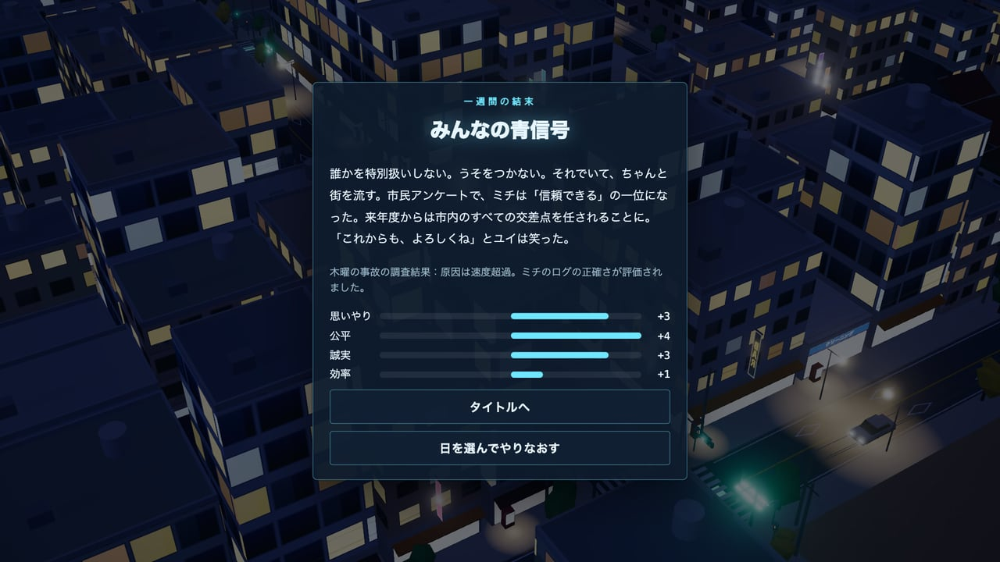

# シグナル・ジレンマ — SIGNAL DILEMMA

街の交通管制AIになって、交差点の信号を切り替える。ブラウザで遊べる 3D の交通シミュレーションゲーム。ときどき、判断に迷う依頼が届きます。

[](https://tanuu5.github.io/signal-dilemma/)
[](https://www.anthropic.com/claude)
[](./LICENSE)
[](#english)

<p align="center">
  
</p>

<p align="center"><b><a href="https://tanuu5.github.io/signal-dilemma/">▶ ブラウザで今すぐ遊ぶ</a></b>（インストール不要。キーボード・マウス・ゲームパッド対応）</p>

**Claude Code × Claude Opus 5.5（MAX）** で作りました。

あなたは市の交通管制AI「ミチ」。左側通行・横型の信号・電柱と電線の並ぶ日本の街のジオラマで、交差点の青の向きを切り替えて、車と歩行者をさばきます。月曜から金曜まで、交差点は 1 つから 9 つへ増え、雨の日、事故、花火大会の夜がやってきます。そして毎日、救急車ではない「お願い」が届きます。猫、運送会社、陣痛の妊婦、令状のない警察、市長の車列、事故ログの書き換え……。選んだ答えで、ミチの一週間の結末（8 種類）が変わります。

建物・車・信号・音楽・効果音まで、画像や音声のファイルは使わず、すべてコードで生成しています。
日本語と英語に対応しています（設定画面の「言語」で切り替え、または URL に `?lang=en`）。English follows below.

## スクリーンショット

<table>
  <tr>
    <td width="50%"><br><sub>タイトル画面。宙に浮かぶ街は、AI が見ている都市の「デジタルツイン」。</sub></td>
    <td width="50%"><br><sub>月曜の朝。交差点をクリックすると、黄・赤をはさんで青の向きが入れかわる。</sub></td>
  </tr>
  <tr>
    <td><br><sub>一日の終わりに業務報告。今日の判断と、それで変わった「性格」も残る。</sub></td>
    <td><br><sub>水曜。「令状はまだだが、全カメラの映像をよこせ」。正解のない依頼に答える。</sub></td>
  </tr>
  <tr>
    <td><br><sub>雨の下校時間。車を全部止めて、傘の子どもたちに歩行者の青を。</sub></td>
    <td><br><sub>木曜。言われたとおり、市長の車列（★）のために青を出し続けるか。</sub></td>
  </tr>
  <tr>
    <td><br><sub>金曜は花火大会。交差点は 9 つ、駅前はスクランブル交差点。</sub></td>
    <td><br><sub>金曜の夜、一週間の結末が決まる（8 種類）。</sub></td>
  </tr>
</table>

画像と動画は、すべて実際のゲーム画面です（業務報告は、確認用の自動操縦で火曜を最後まで遊んだ結果です）。

## 遊び方

| 操作 | キーボード・マウス | ゲームパッド | タッチ |
| --- | --- | --- | --- |
| 青の向きを切り替える | 交差点をクリック／選んで `Space` | A（×） | 交差点をタップ |
| 交差点を選ぶ | `←` `↑` `↓` `→`（数字キー `1`〜`9` で選んで切り替え） | 十字キー | タップ |
| 歩行者の青（車は全部止まる） | `Z`／交差点の上の 🚶 | X（□） | 🚶 か［歩行者］ |
| 自動・手動（水曜から） | `X`／交差点の上の A・M | Y（△） | A・M か［自動］ |
| 思考加速（押しているあいだ時間がゆっくり） | `Shift` | LT・RT | ［思考加速］を押し続ける |
| 早送り | `F` | RB | ［早送り］ |
| 救急車などの知らせへカメラを寄せる | `C` | LB | ［知らせへ］ |
| カメラ | ドラッグで移動・右ドラッグで回転・ホイールで拡大縮小（`W` `A` `S` `D`・`Q` `E` も） | 左スティックで移動・右スティックで回転と拡大縮小 | ドラッグで移動・2 本指で回転と拡大縮小 |
| 全体を見る | `H` | スティックの押し込み | ［全体］ |
| 一時停止 | `Esc`・`P` | Start | Ⅱ |

- 交差点ごとに「南北が青」「東西が青」「歩行者が青」を切り替えます。切り替えには黄と全赤をはさむので、数秒かかります。
- 交差点の真ん中の光の帯が、いま青の向き。停止線の光の幕は信号の色、車線の赤い帯は待っている列の長さです。
- 待たされた車や人が多いほど、上の「満足度」が下がります。0 になると AI は停止されます（1 日目は停止されません）。バスにはたくさん人が乗っているので、待たせると重く響きます。
- 救急車・消防車は赤い点線の道を通ります。先回りして青にしておくと、遅れずに通れます。
- 待ちすぎた歩行者は、信号を無視して渡りはじめます（車が急ブレーキ＝ヒヤリ）。
- 交差点が多い日は「自動」（一定の間隔で切り替わる）も使えます。クリックすれば手動に戻ります。
- 一日の終わりに業務報告（評価 S〜D）。日と日のあいだに、予算で強化（感応式センサー、緊急車両優先など）を導入できます。
- 判断の選び方で「思いやり・公平・誠実・効率」の 4 つが変わり、金曜の夜に一週間の結末が決まります。どの答えにも、正解・不正解はありません。

| 曜日 | 交差点 | 主な出来事 |
| --- | --- | --- |
| 月「はじめての朝」 | 1 | チュートリアル、救急車、下校の時間 |
| 火「ふたつの交差点」 | 2 | 大通りのバス、消防車 |
| 水「雨の街」 | 4 | 一日中の雨、自動の交差点、雨の下校 |
| 木「市長と事故」 | 6 | 市長からの依頼、接触事故 |
| 金「花火の夜」 | 9 | 通行止め、花火大会、スクランブル交差点の人波 |

## 制作について

企画・ディレクション：**たぬ**　／　開発：**Claude Code（Claude Opus 5.5・推論レベル MAX）**

たぬの企画をもとに、ゲームの設計から実装・テストまでを Claude が進めました。交通のシミュレーション（車の追従、右折待ち、救急車に道をゆずる動き、歩行者の横断）は描画と切り離して先に作り、Node だけで回して、車どうしの重なり・止まったまま動かない状態・NaN が出ないことを、地図や信号の制御を変えて繰り返し確かめています。5 日分は確認用の自動操縦でも最後まで遊ばせ、選択肢ごとに結末が分かれることと、操作しないと止められる難しさになっていることを確認しました。最後に、たぬが実際に遊んで、公開の可否を決めています。

## 更新履歴

- **2026-10-10**：公開（v1.0.0）

## 開発

```bash
npm install
npm run dev      # http://127.0.0.1:5181
npm run build    # dist/ に出力
npm run preview  # ビルド結果の確認
```

スマホで試すときは `npx vite --host` で、同じ LAN から開けます。

URL パラメータ：

| パラメータ | 内容 |
| --- | --- |
| `?lang=en`・`?lang=ja` | 表示の言語（設定画面でも変更可） |
| `?quality=high`・`medium`・`low` | 画質（設定画面でも変更可。既定は自動） |
| `?mute` | 音を出さない |
| `?debug` | タイトル画面の版表記に、ビルドの時刻とコミットを出す |
| `?dev` | 確認・撮影用のフック（`window.__dev`）。開発サーバーでは付けなくても有効 |

交通のシミュレーションだけを Node で回して確かめる：

```bash
node dev/simtest.mjs --map 2x2 --ctl auto --min 8 --ev   # 重なり・NaN・止まったままの状態を調べる
```

| 場所 | 中身 |
| --- | --- |
| `src/game/sim/` | 交通のシミュレーション（道路網・信号・車・歩行者。描画とは切り離している） |
| `src/game/view/` | 街・車・歩行者・信号・空・雨・花火・情報の重ね表示（Three.js） |
| `src/game/campaign/` | 5 日間の台本、判断に迷う依頼、結末、強化 |
| `src/game/Director.js` | 一日の進行（時計・交通量・出来事・満足度） |
| `src/game/Game.js` | 画面の状態と操作 |
| `src/audio/` | 効果音・BGM の合成（Web Audio） |
| `src/i18n/` | 日本語・英語の辞書 |
| `dev/` | 確認用の道具（撮影用のフック、音の試聴ページ、シミュレーションの検証） |

## GitHub Pages で公開する

`main` に push すると、`.github/workflows/deploy.yml` がビルドして GitHub Pages に公開します。初回だけ、リポジトリの Settings → Pages → Source を「GitHub Actions」にします。

## クレジット・ライセンス

- コード：MIT License（[LICENSE](LICENSE)）© 2026 たぬ
- 3D 描画：[three.js](https://threejs.org/)（MIT License、ビルドに同梱）
- 文字は端末に入っているフォントを使い、外部からは読み込みません。
- 街・会社・人物（ソラマメ便、県警の久我、市長など）は、すべて架空です。
- MIT License の対象はこのリポジトリのコードと文章です。「Claude」の名前や商標の使用を許諾するものではありません。

---

## English

**▶ Play in your browser: https://tanuu5.github.io/signal-dilemma/**

You are MICHI, a city's traffic-control AI. A 3D browser game made with **Claude Code × Claude Opus 5.5 (MAX)**: switch the signals of a small Japanese town (left-hand traffic, horizontal traffic lights, utility poles) and keep cars, buses and pedestrians moving. Switch to English from the Settings screen, or add `?lang=en` to the URL.

- Five days, Monday to Friday: from one intersection to nine, with rain, a crash, and a fireworks night with a scramble crossing.
- Clear the way for ambulances and fire engines along their red dotted route; keep waiting pedestrians from crossing on red.
- Every day brings a request with no right answer — a cat asleep in the crossing, a company offering money for green lights, police asking for camera feeds without a warrant, the mayor's motorcade, a crash log you could quietly edit. Your choices lead to one of eight endings.
- Everything is generated in code — no image or audio files.

Controls: click / tap an intersection to switch it · arrows + `Space` to select and switch · `Z` pedestrian green · `X` auto/manual · hold `Shift` to slow time · `F` fast-forward · drag / wheel to move the camera · `Esc` pause. Gamepads work too.

Code is released under the MIT License. Built with three.js (MIT).
